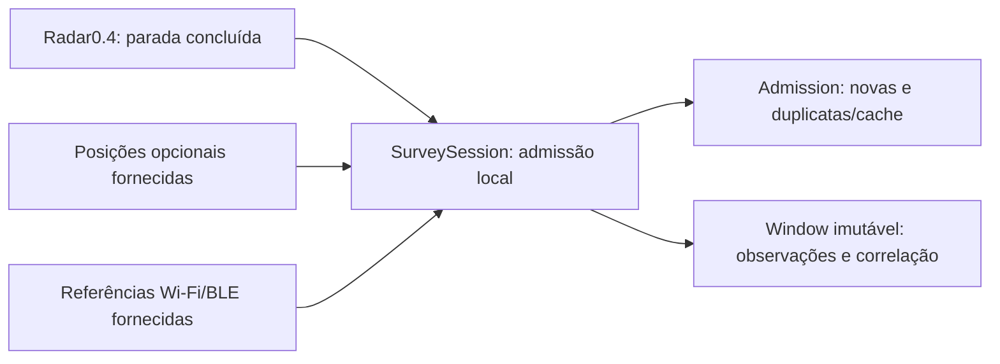

# Próxima fatia local: paradas, posições opcionais e referências

Base canônica: casca-de-bala main018c0109cf010691ef488f860d266282f6886dab.
Desenvolvimento local posterior à0.4, não incluído no APK entregue. Não houve
build/assinatura, scan, coleta real ou alteração do manifesto nesta etapa.

## Fatia implementada e limites

SurveySession recebe o RadarSession.Snapshot real já existente, encontra uma
parada finalizada pelo ID e associa um lote de observações tipadas. Reutiliza o
objeto RadarSession.Point; não duplica o coordenador, sua estatística RSSI ou sua
conexão. Não existe adaptador LocationManager/WifiManager/BLE novo nem coleta
ativada. Fixtures e posições de teste são explicitamente SYNTHETIC.



A janela manual sem observações continua sem coordenadas. Não criar posição0,0,
precisão automática, mapa probabilístico ou distância RSSI. Referência observada
não é âncora de posição conhecida. Não existe solver, trilateração ou média GPS.
O APK0.4 publicado continua baseline enquanto o radar físico é testado.

## Contrato executável

- **Stamp:** measuredNs opcional, receivedNs, requestedNs opcional, aquisição
  declarada NEW/CACHE/UNKNOWN e correlationGroup. Todos os tempos no mesmo
  elapsedRealtime da mesma inicialização do telefone. Não usar hora UTC para joins.
- **Observation.position:** coordenadas fornecidas, provider declarado GNSS/
  NETWORK/FUSED/UNKNOWN, precisão concedida APPROXIMATE/PRECISE/UNKNOWN e raio
  horizontal informado ou null. Rejeita NaN/infinito, faixas inválidas e raio negativo.
  Não preencher coordenadas quando a API não entregar fix. PRECISE é categoria
  de permissão, não prova de precisão física ou de autenticidade do GNSS.
- **Observation.reference:** WIFI_REFERENCE ou BLE_REFERENCE, ID local efêmero
  e RSSI bruto. Coordenadas/raio são null, nunca inferidos do sinal. Os limites
  -127..126 são política do contrato; o adaptador futuro precisa interpretar
  sentinelas e limitações da API de origem antes da admissão.
- **Origin:** deve coincidir com a origem do radar. Misturar fixtures e callback
  declarado do app é recusado. Declaração não é atestação de hardware. Ainda não
  há ingestão de um formato externo nem importação entre processos/reboots.
- **Scope:** POSITION/WIFI_REFERENCE/BLE_REFERENCE separados. O host confiável
  fornece consentimento; isso não concede permissão Android. revoke impede novas
  admissões dessa categoria. close impede todas, preservando os resultados em
  memória. Revogar não apaga silenciosamente observações anteriores; a UI futura
  deve oferecer descarte explícito. Não existe arquivo ou upload automático.

Freshness é calculada, não copiada da palavra NEW do caller:

| Resultado | Regra |
| --- | --- |
| CACHED | Origem declara cache ou medição antecede seu pedido |
| UNKNOWN | Falta timestamp/pedido ou a aquisição é desconhecida |
| OUTSIDE_WINDOW | Timestamp nominal fora da parada concluída |
| WINDOW_EDGE_UNCERTAIN | Cai no milissegundo de fronteira do Radar0.4 |
| NEW_FOR_WINDOW | Relatada como nova, posterior ao pedido e dentro da janela |

O radar0.4 usa milissegundos; a fronteira não ganha precisão de nanos por
multiplicação. O milissegundo inicial/final recebe classificação incerta e não
incrementa newForWindow. Novo para a janela também não significa fresco agora:
idade no recebimento é preservada separadamente. Não comparar clocks entre
boots/dispositivos; como não há persistência/import, o futuro adaptador deve
estabelecer esse domínio antes de admitir dados. Incerteza temporal reportada
pelo provedor e flags mock exigem revisão explícita no adaptador futuro, ainda
não implementado; o contrato não certifica uma cadeia de medição física.

Deduplicação é por janela, tipo/provedor ou referência local e instante medido.
Sem instante, usa measurementRef local e mantém UNKNOWN. Mesmo fix retornado
novamente não vira nova medição. Payload divergente para a mesma identidade gera
CONFLICT, sem substituir raio/posição. Admission informa inserted,
duplicateDeliveries, cachedDuplicateDeliveries e newForWindow: a UI não precisa
confundir uma nova entrega de cache com um novo fix. Mantém a primeira
observação; não guarda todas as releituras duplicadas.

Lote atômico em memória: até64 entradas por chamada,64 observações únicas por
parada e8 paradas. Erro de origem, tempo, consentimento, conflito ou limite não
aplica parte do lote, não avança o relógio de admissão nem elimina dados antigos.
IDs de geração antigos são recusados. O modelo é confinado a um thread, como o
radar; não implementar concorrência chamando-o simultaneamente de callbacks.

CorrelationGroup identifica o lote/fluxo correlacionado informado pelo adaptador.
O conjunto de grupos é preservado, mas não significa número de amostras
independentes. Nenhum raio é reduzido por sqrt(n); nenhuma probabilidade espacial
ou confiança combinada é calculada. IDs locais não são anonimização garantida:
não inserir SSID/BSSID/MAC/nomes reais. O adaptador futuro deve manter mapeamento
privado efêmero, com limites, sem logar IDs ou coordenadas.

## Tempo e incerteza: fontes primárias

Location fornece tempo monotônico desde boot e raio horizontal no nível nominal
68%; preservar hasAccuracy/null. Esse raio reportado não é garantia indoor nem
intervalo recalibrado pelo app. [Location](https://developer.android.com/reference/android/location/Location).

Wi-Fi ScanResult.timestamp é microssegundos desde boot; BLE getTimestampNanos
é o tempo observado do anúncio desde boot. Os conversores usam multiplicação
com overflow rejeitado; o recebimento do callback não substitui a medição.
[Wi-Fi ScanResult](https://developer.android.com/reference/android/net/wifi/ScanResult#timestamp),
[BLE ScanResult](https://developer.android.com/reference/android/bluetooth/le/ScanResult#getTimestampNanos()).

## Plano pequeno de UI, ainda não implementado

1. Manter andar → parar → medir e a lista ordinal da0.4. A parada existe sem
   coordenadas; rótulo manual opcional não autoriza sensores. Sem fix, mostrar
   Sem posição nesta parada; nunca colocar ponto geográfico de fallback.
2. Opção Incluir posição do telefone, desligada por padrão. Explicar que é local,
   temporária e pode ser imprecisa indoor. Pedir permissão só no toque; permitir
   recusar/ficar aproximada e continuar RSSI/manual. Estados: desligado, pedindo
   consentimento/permissão, aguardando, observada, cache/antiga, sem fix ou negada.
3. Por parada, mostrar horário relativo/idade, provedor real e raio informado ou
   precisão indisponível, junto de amostras novas/cache/correlacionadas. Não chamar
   FUSED de GPS nem somar probabilidades. Só desenhar coordenadas observadas com
   indicação de incerteza; a lista manual continua se não houver coordenadas.
4. Wi-Fi/BLE de referência ficam para consentimentos e adaptadores separados,
   após validar a posição opcional. Sem câmera, conexão a AP, RTT, pareamento de
   beacons, conta, mapa remoto ou serviço em background nesta fatia. Sair/rotacionar
   cancela adaptadores e fecha SurveySession; voltar não deve recomeçar sozinho.

## Permissões por adaptação futura — nenhuma adicionada agora

Para minSdk31/target35 da0.4:

| Função | Necessidade futura | Motivo e fallback |
| --- | --- | --- |
| Parada manual + RSSI conectado atual | CONNECT já existente | Não requer localização ou Wi-Fi |
| Posição aproximada opcional | COARSE foreground | Aceitar dados aproximados, sem fix ou recusa |
| Solicitar posição precisa opcional | FINE junto com COARSE no Android12+ | Pedir apenas no opt-in; usuário pode conceder aproximada |
| Ler resultados Wi-Fi | FINE + ACCESS_WIFI_STATE e localização do sistema ligada | Resultado pode ser cache; não inferir AP ausente por falha |
| Pedir novo scan Wi-Fi | Além disso CHANGE_WIFI_STATE | Falha/throttling não gera amostra nova |
| BLE como referência para derivar posição | SCAN + FINE; CONNECT só onde o método exigir | Revisar/remover neverForLocation no manifesto da futura versão |

Permissões de localização são incrementais e somente com Activity visível; não
pedir BACKGROUND_LOCATION/foreground service/câmera/Internet neste fluxo.
COARSE não transforma GNSS em medição precisa; selecionar provedor existente e
exibir o que foi retornado, com cancelamento e limite, é trabalho do adaptador.
[Localização foreground](https://developer.android.com/develop/sensors-and-location/location/permissions),
[Pedido preciso/aproximado](https://developer.android.com/develop/sensors-and-location/location/permissions/runtime).

NEARBY_WIFI_DEVICES não substitui FINE para startScan/getScanResults mesmo no
Android13+. Não adicioná-la por antecipação só para essa lista de referências;
ela deve ser considerada se forem escolhidas outras APIs de Wi-Fi que a exijam.
[Permissões Wi-Fi](https://developer.android.com/develop/connectivity/wifi/wifi-permissions).

Wi-Fi pode retornar resultados antigos e seus scans foreground são limitados
(a documentação indica4 por2min). Guardar timestamps por resultado e atualização
do lote; não solicitar um scan para cada amostra RSSI nem desligar throttling.
[Scan Wi-Fi](https://developer.android.com/develop/connectivity/wifi/wifi-scan).

neverForLocation é uma declaração sobre uso, não autorização de localização.
A futura função que usa anúncios como referência espacial não pode mantê-la
indiscriminadamente; pode inclusive perder beacons filtrados. A0.4 não é alterada.
[Permissões Bluetooth](https://developer.android.com/develop/connectivity/bluetooth/bt-permissions).

## Testes e próximos gates

```sh
sh android-bridge/run_survey_host.sh
```

TDD RED: teste não compilou antes de SurveySession. GREEN: compilação host com
-Xlint:all -Werror, RadarSessionTest e SurveySessionTest. Cenários incluem parada
sem coordenadas, cache declarado/implícito, timestamp desconhecido/fora/fronteira,
precisão ausente/infinita, origem, consentimento/revogação, deduplicação com recibo,
rollback por conflito, limite64/65 e conversões/overflow de unidades.

NOT_RUN: APK/assinatura, UI/ART, GPS/Wi-Fi/BLE reais, persistência, estimador ou
MCP remoto. Manifesto e179 arquivos da baseline permanecem idênticos; nada foi
publicado. Antes de outro APK: receber teste físico da0.4, escolher somente o
adaptador de posição foreground e seu consentimento, validar timestamps/cache e
fazer teste manual de concessão aproximada/negada/sem fix/cancelamento. Referências
Wi-Fi/BLE continuam um gate posterior, não capacidades já habilitadas.
